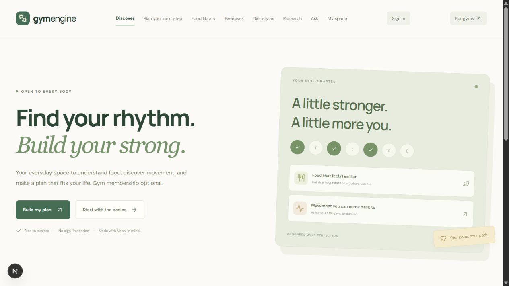

# Gym Engine

**Learn about fitness. Build a routine. Track your progress. Run your gym.**

Gym Engine is a web platform for gym-goers, fitness enthusiasts, independent exercisers, and gym operators. It brings public fitness education, personal planning and tracking, and daily gym operations into connected experiences. The initial gym-management audience is independent gyms in Nepal, with broader and multi-gym support planned.

[](https://github.com/sudip-parajuli/gym-engine/actions/workflows/platform.yml)

**Status:** active development. The local application works; production services and several advanced workflows still need configuration or implementation. See [feature status](docs/features.md) before evaluating it for live use.



## Who is it for?

| Audience      | Experience                                                                                                                         |
| ------------- | ---------------------------------------------------------------------------------------------------------------------------------- |
| Visitors      | Read fitness and diet guides, explore foods and exercises, ask the research helper, and create one-time drafts without signing in. |
| Individuals   | Create an account to save plans, record food intake and workouts, and follow personal progress. No gym membership is required.     |
| Gym operators | Manage members, memberships, recorded payments, attendance, and daily reports through a separate staff workspace.                  |

## Features

### Fitness knowledge, open to everyone

- Evidence guides covering balanced, plant-based, keto, meat-forward/carnivore, fasting, and DASH topics, plus accessible movement and individual training needs.
- Food references with listed ingredient exclusions and practical uses.
- Exercise references filtered by muscle group, home/gym equipment, and seated/standing/floor position.
- A research helper that retrieves relevant guides and original sources. Optional AI explanations are prepared and require configuration and visitor consent.

### Personal planning and progress

- Editable meal and exercise drafts based on goals, food preference, experience, available days, equipment, and functional needs.
- Optional resting-energy estimates from age, height, and weight; these are not daily intake prescriptions.
- Email/password accounts with personal intake, workout, saved-plan, and optional body-measurement records.
- Account-owned storage, concurrent-save protection, and JSON export.

### Gym operations

- Local owner setup and staff sign-in.
- Member records, memberships, and renewal reminders.
- NPR billing balances, partial payment records, and receipts.
- Staff-assisted attendance, duplicate check-in prevention, and dashboard reports.

**Scope matters:** the content and movement catalogs are growing, not exhaustive. Clinical contexts and restrictive diets require professional review. Google/Microsoft sign-in and AI need credentials; ChatGPT sign-in requires approved partner access. Staff storage remains local and is disabled on Vercel until migrated. [See implemented, configurable, and planned features →](docs/features.md)

## Quick start

Requires **Node.js 22.17+** and npm.

```sh
git clone https://github.com/sudip-parajuli/gym-engine.git
cd gym-engine/platform
npm ci
npm run dev
```

Open **http://127.0.0.1:3000**. Browse anonymously, visit `/account` for personal records, or `/login` for local gym-owner setup. No external service is required for the basic local experience.

For optional integrations, copy `platform/.env.example` to `platform/.env.local` and follow the [setup guide](docs/getting-started.md). Never commit real credentials or application data.

## Documentation

| Guide                                                                        | What you will find                                                     |
| ---------------------------------------------------------------------------- | ---------------------------------------------------------------------- |
| [Documentation index](docs/README.md)                                        | Choose the right guide for your role                                   |
| [Features and access](docs/features.md)                                      | Product capabilities, user journeys, routes, and implementation status |
| [Getting started](docs/getting-started.md)                                   | Installation, configuration, validation, and troubleshooting           |
| [Architecture](docs/architecture.md)                                         | Modules, authentication, storage, APIs, and data boundaries            |
| [Deployment and integrations](docs/deployment.md)                            | PostgreSQL, Vercel, email, OAuth, AI, and indexing                     |
| [Privacy and recommendation boundaries](docs/privacy-and-recommendations.md) | Records, AI consent, evidence, and planning limits                     |
| [Roadmap](docs/roadmap.md)                                                   | Production hardening and future product work                           |
| [Contributing](CONTRIBUTING.md)                                              | Development workflow and pull-request expectations                     |
| [Security](SECURITY.md)                                                      | Reporting vulnerabilities responsibly                                  |

## Technology

Next.js App Router · React · TypeScript · Better Auth · PostgreSQL for hosted personal accounts · SQLite for local development · Lucide icons. The current implementation uses deterministic planning templates and source retrieval; it does not include a trained ML recommendation model.

## Repository structure

```text
platform/                 Current Next.js application
  app/                    Public pages, personal tools, staff workspace, APIs
  lib/                    Domain logic, authentication, storage, evidence catalog
  scripts/                Personal database migrations
  tests/                  Domain, planning, and knowledge checks
docs/                     Product and engineering documentation
.github/                  CI and contribution templates
```

## Development checks

Run from `platform/`:

```sh
npm test
npx tsc --noEmit
npm run build
```

## License

A project license has not been selected yet. Public source availability does not by itself grant an open-source license.
